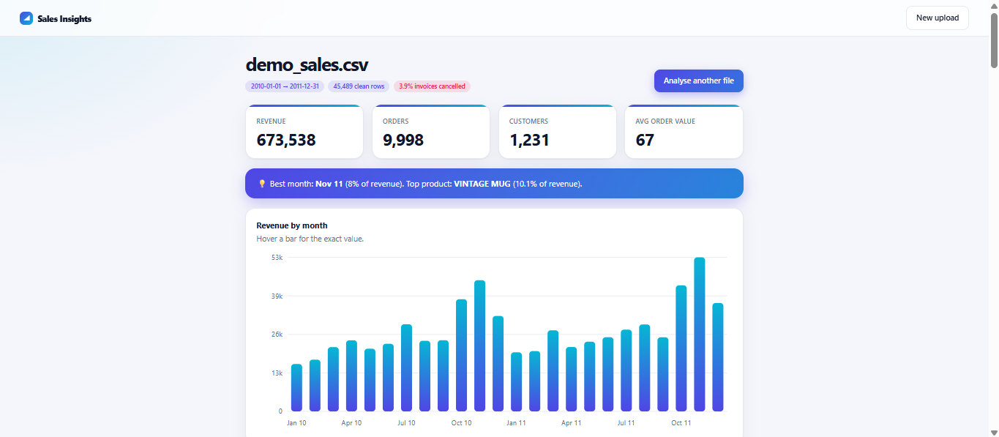
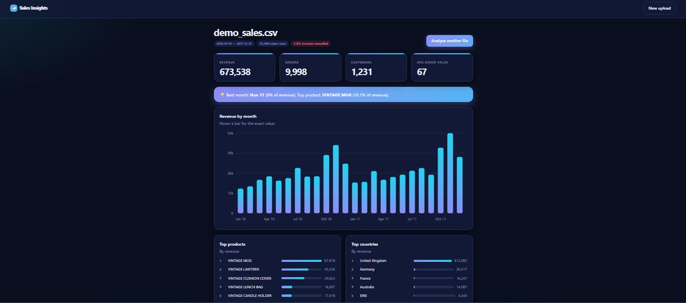
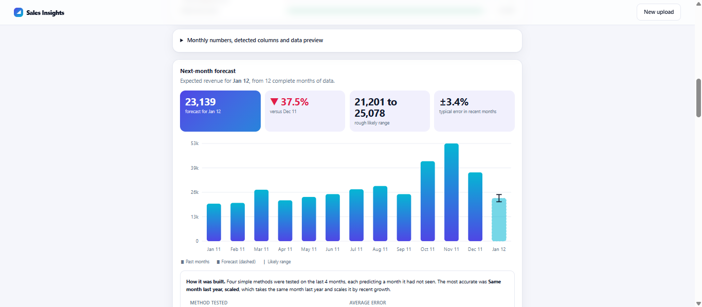

# Sales Insights


Upload a sales CSV and get a cleaned dataset, KPIs, customer segments, a next-month forecast and plain-English recommendations. Built with Django and pandas.

**Live demo:** https://arslan.pythonanywhere.com
**No data?** Download the [synthetic sample file](sample_data/demo_sales.csv) and upload it.

| Light | Dark |
|---|---|
|  |  |



## What it answers
- How much did we sell, and how is it trending month by month?
- Which products, countries and customers matter most?
- Who are our best, new, at-risk and lost customers?
- How many customers come back, and how dependent are we on a few buyers?
- When do customers buy (weekday, hour, quarter)?
- What will next month look like, and how reliable is that estimate?
- What should we do first? (rule-based recommendations)

## How it works
1. **Upload and validate.** Column names are matched automatically (`Customer ID`, `customer_id` and `CustomerID` all work). The file type, size, required columns and data types are checked before anything is saved.
2. **Clean.** Each cleaning step is counted and shown on the dashboard, so nothing is removed silently.
3. **Summarise once.** pandas computes the KPIs and insights at upload time and stores a small JSON summary, so the dashboard loads instantly instead of re-reading every row.
4. **Visualise.** Charts are plain SVG drawn in the browser. There is no chart library and no build step.

## Data cleaning decisions
| Step | Why |
|---|---|
| Remove cancelled invoices (start with `C`) | Negative quantities would understate sales. The cancellation rate is still reported as its own KPI. |
| Remove zero or negative quantity and price | Data-entry errors and adjustments, not real sales. |
| Remove non-product codes (postage, fees, adjustments) | Not products, so they distort product rankings. |
| Remove exact duplicate rows | Double counting. |
| Keep rows with no customer ID | They are real sales. They count toward revenue but not toward customer numbers. |

## Forecasting
The forecast uses only complete months, so a partial month never looks like a sales crash. Four simple methods are tested on the most recent months, each predicting a month it has not seen: last month repeated, a 3-month average, a linear trend, and same-month-last-year scaled by recent growth. The most accurate one is used, and its typical error and a rough range are shown next to the number. I chose simple methods over machine learning because a few dozen monthly points cannot support a complex model honestly.

## Customer segments
Customers with an ID are grouped by recency and frequency:

| Segment | Rule |
|---|---|
| Champions | 4+ orders, last purchase within 90 days |
| Loyal | 2+ orders, active within 12 months |
| New | 1 order, within the last 90 days |
| Occasional | 1 order, 3 to 12 months ago |
| At risk | 2+ orders, silent for 6 to 12 months |
| Lost | No purchase for over 12 months |

These thresholds are simple starting points and should be tuned to the business. Recency is measured from the last date in the uploaded file.

## About the sample data
`sample_data/demo_sales.csv` is **synthetic**, generated by `scripts/make_demo_data.py` with a fixed random seed. It follows the column layout of the public Online Retail II dataset and includes growth, a Q4 peak, cancellations and missing customer IDs so every feature has something to show. Its numbers are not real company results.

## Tech stack
Python · Django 5 · pandas · NumPy · SVG and vanilla JavaScript · SQLite · WhiteNoise · Gunicorn · GitHub Actions

## Run locally
```bash
git clone https://github.com/Arslan3x5/sales-insights.git
cd sales-insights
python -m venv .venv
source .venv/bin/activate        # Windows: .venv\Scripts\activate
pip install -r requirements.txt
python manage.py migrate
python manage.py runserver
```
Open http://127.0.0.1:8000 and upload `sample_data/demo_sales.csv`.

Run the tests with `python manage.py test`.

## Configuration
| Variable | Purpose |
|---|---|
| `SECRET_KEY` | Django secret key |
| `DEBUG` | `1` for development, `0` for production |
| `ALLOWED_HOSTS` | Comma-separated hostnames |
| `CSRF_TRUSTED_ORIGINS` | Comma-separated origins, e.g. `https://yourname.pythonanywhere.com` |
| `UPLOAD_MAX_MB` | Maximum upload size (default 25) |

## Limitations
- This is a public demo with no user accounts. Uploaded results can be viewed by other visitors, so please use the synthetic sample file or non-sensitive data.

## Roadmap
- [ ] User accounts and private datasets
- [ ] Export the dashboard as a PDF report
- [ ] Configurable segment thresholds
- [ ] Column-mapping screen for unusual file layouts

## License
MIT
